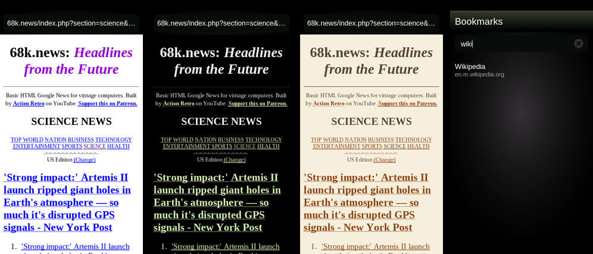

# NetMee for Nokia N9

A light web browser for the Nokia N9 (MeeGo Harmattan PR1.3), made in the N9
style: a dark background for the AMOLED screen, an address bar, back, home,
a star for bookmarks and a bookmark list with pull-down search.

Pages are shown the way their authors made them, or in a **dark** (light text
on black) or **sepia** (e-book reader colours) look. What NetMee adds is
control over what the old engine has to load, so the app stays responsive:

- every request is checked before it leaves the phone: ad and tracker servers
  from `blocklist.txt` are refused;
- scripts from other sites can be refused, and a script bigger than a set
  limit (100 / 200 / 500 KB or no limit) is cut off as soon as its size is known;
- a script that runs too long is stopped automatically, so the app never hangs;
- JavaScript can be switched on or off per site (light sites such as FrogFind,
  68k.news and wiby.me start with it off);
- reader mode through FrogFind for pages the old engine cannot show;
- search from the address bar with DuckDuckGo Lite (default), FrogFind,
  wiby.me or your own search address (`%s` marks where the words go).

Engine: the system QtWebKit (Qt 4.7). For HTTPS with TLS 1.2 install the
[TLS 1.2 patch by WunderWungiel](https://wunderwungiel.pl/MeeGo/) first.
Languages: English, Polish, German, Spanish, Italian, French (from the phone
settings). Translations are welcome: see `qml/strings.js`.

## Install

Copy `dist/netmee-n9_0.1.3_armel.deb` to the phone (for example to
`/home/developer/`) and install it as root:

    aegis-dpkg -i /home/developer/netmee-n9_0.1.3_armel.deb

`aegis-dpkg` comes from CODeRUS' Aegis-install hack (also inside N9 QTweak).
Start NetMee from its icon.

## Build

`build.sh` cross-builds the launcher with clang against the Harmattan
libraries (Qt 4.7.4, QtWebKit, QtDeclarative); `packaging/make-deb.sh` makes
the package. `tools/icon.py` draws the icon.

## Credits

Designed and written by Claude (Anthropic) together with smyhu.

MIT License, Copyright (c) 2026 smyhu.
